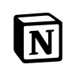
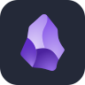
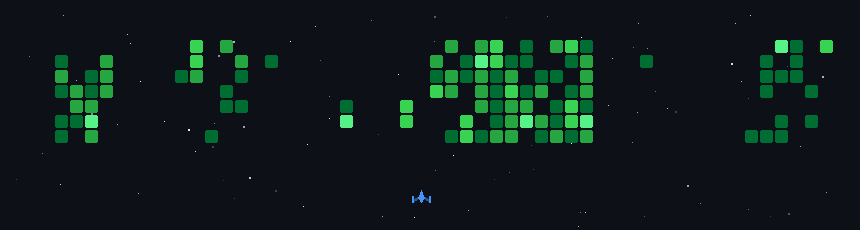
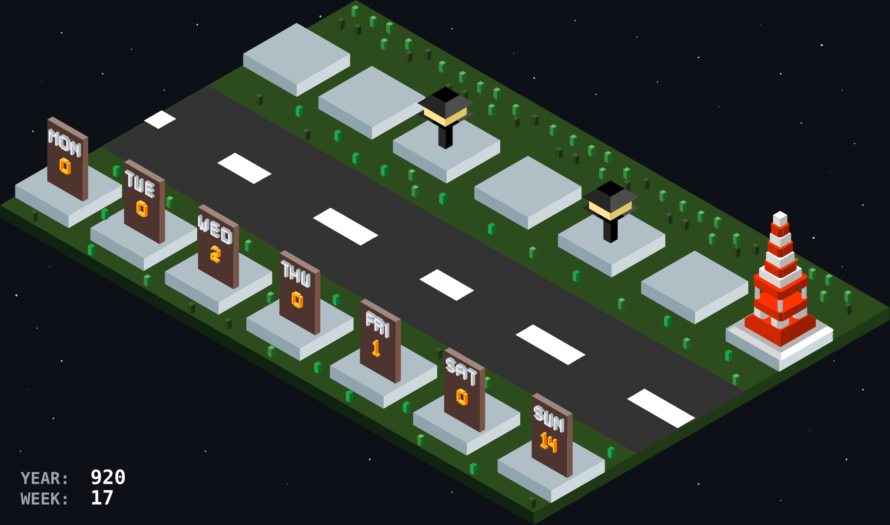
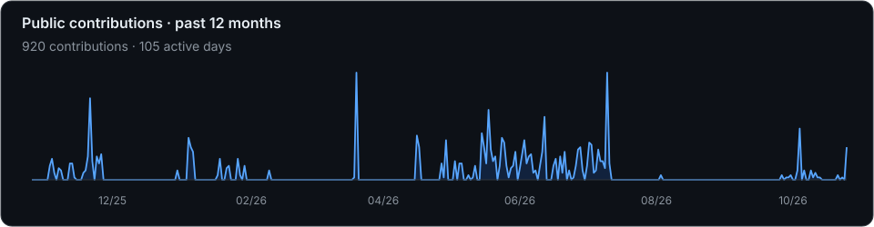

<!-- Profile banner -->
<picture>
  <source media="(max-width: 600px)" srcset="assets/header-mobile.svg" />
  
</picture>

<!-- Typing SVG -->

<!-- Social Badges -->

---

## ⚡ About Me

I'm a computer science student interested in AI agents and automation. I experiment with MCP, reusable agent skills and local models to connect AI with tools and data. My projects range from Python utilities and Telegram bots to web apps and M.A.Y.A., a small smart-home prototype.

  <picture>
    <source media="(max-width: 600px)" srcset="assets/terminal-mobile.svg" />
    
  </picture>

---

## 🛠️ Tech Stack

<strong>AI &amp; Agent Tools</strong>

Tool integration · Agent workflows · Local models

<strong>Languages</strong>

Automation scripts · Web interfaces · School projects

<strong>Backend &amp; Data</strong>

APIs · Small services · Local databases

<strong>Apps &amp; Services</strong>

Workflow automation · Knowledge management · Project organization

---

## 🚀 Featured Projects

<table>
  <tr>
    <td width="50%" align="center">
      <h3>🤖 M.A.Y.A. AI Assistant</h3>
      
        
      
A smart-home prototype using Ollama and FastAPI on a PC, with Arduino controlling lights, servos and sensors. Presented at Arduino Day 2026.

      

        
        
        
      

      
    </td>
    <td width="50%" align="center">
      <h3>🗂️ Download Organizer</h3>
      
        
      
A Python utility for organizing downloads on Windows. Uses SQLite to track files, supports local semantic classification and starts new setups in dry-run mode.

      

        
        
      

      
    </td>
  </tr>
  <tr>
    <td width="50%" align="center">
      <h3>⛽ Fuel Tracker Bot</h3>
      
        
      
A Telegram bot and Mini App for checking nearby fuel prices, with a Leaflet map, MASE data and preferences stored on the user’s device.

      

        
        
      

      
    </td>
    <td width="50%" align="center">
      <h3>🧵 Tailoring Inventory</h3>
      
        
      
A school project in C for tracking fabric rolls, withdrawals and offcuts, with persistent storage and a web interface for the inventory.

      

        
        
      

      
    </td>
  </tr>
</table>

---

## 🚀 Contribution Arcade

<strong>Space Shooter</strong> My public contribution calendar as a space-shooter animation.

  <picture>
    <source media="(prefers-reduced-motion: reduce)" srcset="assets/space-shooter-static.png" />
    
  </picture>

<strong>Contribution City</strong> One building per day over the past week. Building size follows the contribution count.

  

Public contribution snapshot: <!-- contribution-date -->2026-10-25<!-- /contribution-date -->.

---

## 🐍 Contribution Snake

<picture>
  <source media="(prefers-color-scheme: dark)" srcset="https://github.com/gabrielerossoni/gabrielerossoni/raw/main/output/github-contribution-grid-snake-dark.svg">
  <source media="(prefers-color-scheme: light)" srcset="https://raw.githubusercontent.com/gabrielerossoni/gabrielerossoni/main/output/github-contribution-grid-snake.svg">
  
</picture>

---

## 📊 GitHub Analytics

 

 

<picture>
  <source media="(max-width: 600px)" srcset="assets/activity-mobile.svg" />
  
</picture>

---

## 📫 Connect With Me

